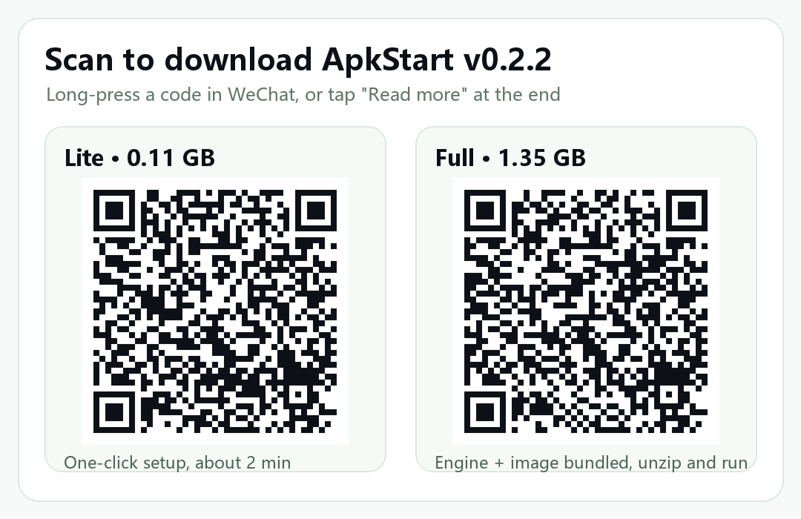

# Double-click an .apk, run an Android app on your PC

Opening an Android app on Windows usually means: downloading a multi-gigabyte emulator → setting up the environment → finding the APK → dragging it in → putting up with popups and fans at full blast. And after all that you may still get `INSTALL_FAILED_NO_MATCHING_ABIS` — the package only ships ARM native libraries and will not install.

So I wrote my own: **ApkStart**.

It is an ultra-light Android app launcher for Windows: associate `.apk` files with it, **double-click to install**, with a desktop shortcut created automatically, one independent window per app, and a shared folder between the PC and Android for dragging files in both directions.

## Four features, usable right after install

**① Double-click to install.** After associating `.apk`, a double-click installs it; the app name and icon are read automatically and the desktop shortcut is created in one step — no emulator console to open.

**② Independent windows.** Each app runs in its own freely resizable window (`am start --windowingMode 5`), out of the way of the others, laid out like native Windows programs.

**③ File interchange.** `%USERPROFILE%\ApkStartShared` is wired to the shared directory inside Android; drag a file in from the PC and the app can open it directly.

**④ Official engine + hardware acceleration.** The base is Google's official Android Emulator and the AEHD driver; official sources are downloaded with 8 parallel threads, runtime components are verified and managed by the app itself, and the shell has zero third-party dependencies.

## v0.2.2: this time the "hassle" is gone for good

The new version does two things.

**First, the full edition works out of the box.** Previously the first launch needed a click on "one-click deploy" to download the engine and image (about 2 minutes). Now the full edition packs all of it into the installer: the runtime engine, platform-tools, the AEHD driver, and an Android 14 compatibility image with the ARM translation layer. Unzip and double-click `ApkStart.exe`, all four checks come back green, and you are on the main screen — **zero downloads, zero setup**.

**Second, ByteDance apps now run.** Previously packages like Hongguo Short Dramas that only ship arm64-v8a crashed right after the privacy dialog on the old API 30 image (in `libndk_translation`, at `DoBadTrampoline`). With the Android 14 image the new translation layer fixes it: tested end to end, the install succeeds, the recommendation feed loads, video plays normally, and swiping between videos does not crash.

Just turn on "ARM compatibility mode" in the settings; ordinary ARM-only apps benefit as well. A few apps with deeper anti-emulator checks (verifying real sensors / baseband) may still be limited — that is stated honestly here.

## Download: two editions, take your pick

> WeChat article bodies do not allow installer attachments, so what is here is a **QR code that links straight to the installer**: long-press to scan and download; or scroll to the end and tap **"Read original"** to reach the GitHub Release page.

| Edition | Size | Who it is for |
| --- | --- | --- |
| Lightweight `win64-portable.zip` | 0.11 GB | Click "one-click deploy" on first launch; the engine and image are installed automatically in about 2 minutes |
| **Full `win64-full.7z.001` (recommended)** | 1.35 GB | Bundles all components and the ARM compatibility image: unzip, double-click, done, zero downloads and zero setup |

The full edition is a 7z volume: extract `.001` with 7-Zip / WinRAR / Bandizip; the current version has a single volume. Both editions are portable and need no administrator install.

The project is fully open source: <https://github.com/RoutineMiku/apkstart>. Stars, issues and PRs are welcome; releasing a new version only needs a tag, and GitHub Actions builds and publishes both packages automatically.

## About the author

**ApkStart is developed and maintained by RoutineMiku**, powered by RoutineMiku.

The WeChat account and Douyin QR codes are below, and they are also in the app under "Settings → About"; come find me if you run into problems.

Douyin handle **RoutineMiku (日常MIKU)**, profile link: <https://v.douyin.com/9TIIxVCANig/>

---

*The project uses the MIT license. The lightweight edition's runtime components are downloaded on demand from Google's official sources on the user's machine; the full edition bundles them for convenience, and those components remain under their own licenses.*
